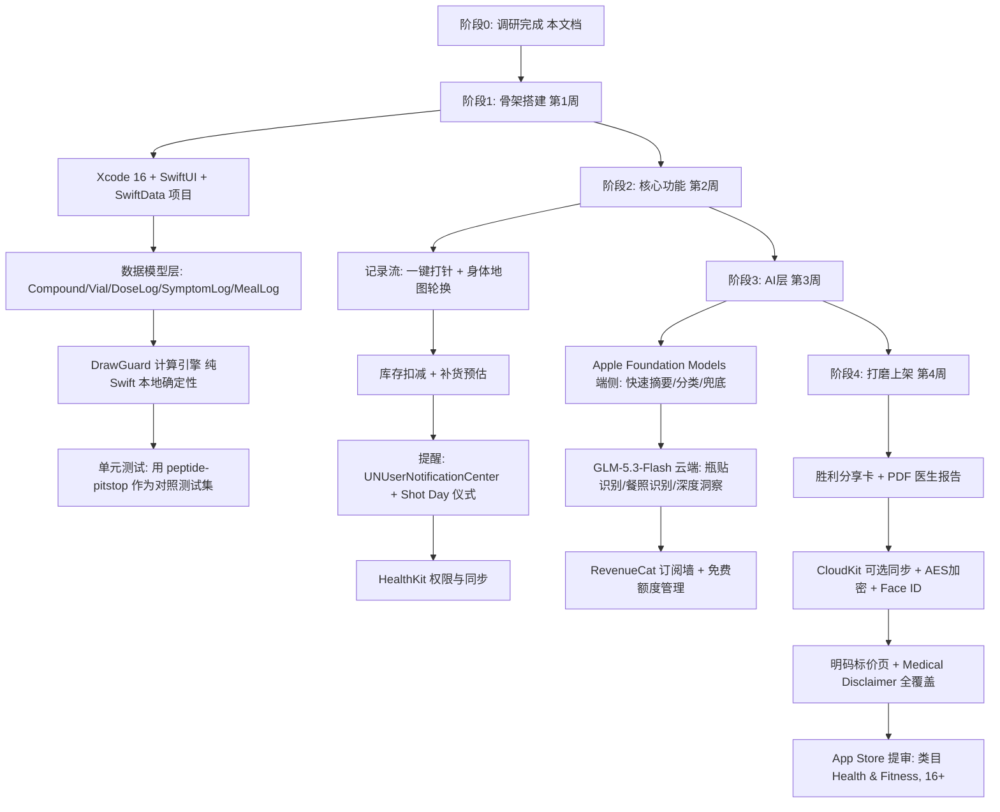
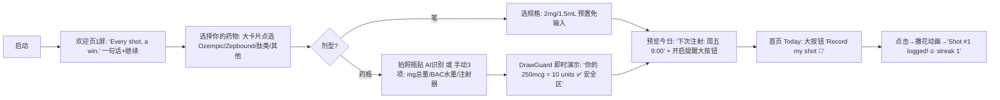
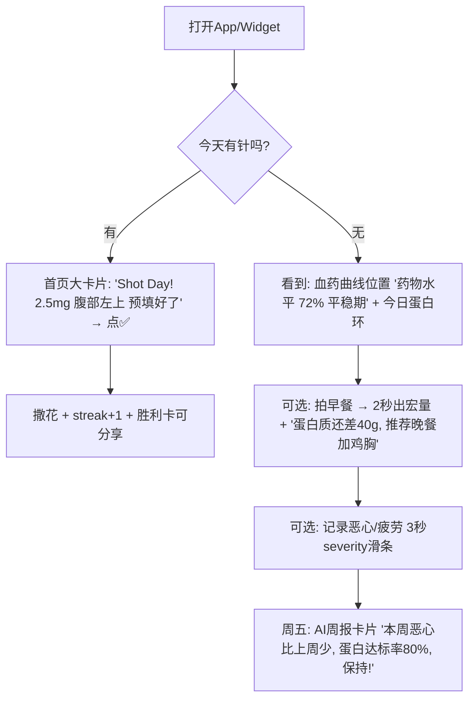
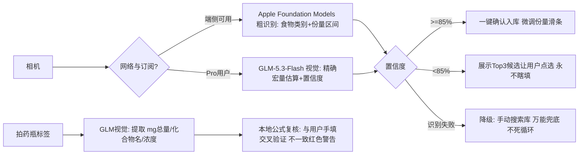
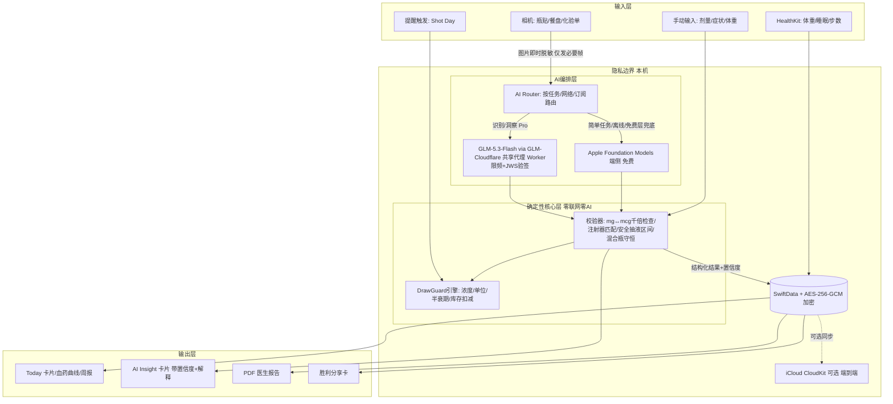
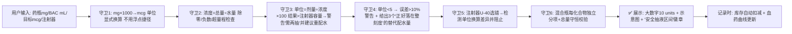
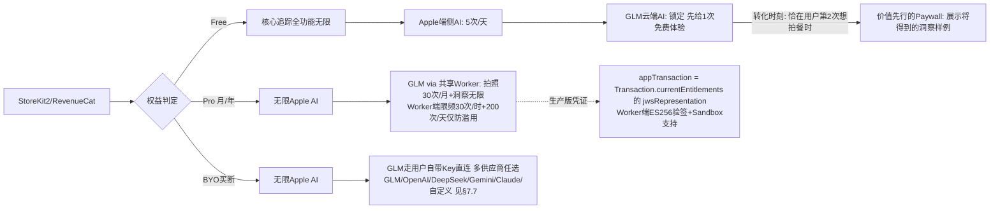
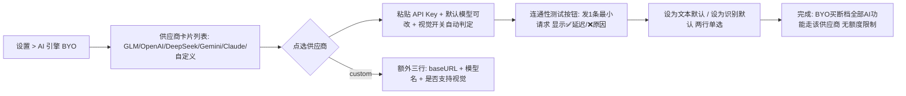

# TR-20260930-ShotJoy GLP-1肽类注射智能管家 操作指南

> **APP 正式名称**：**ShotJoy**
> **APP 副标题（Subtitle）**：GLP-1 & Peptide Shot Tracker
> **目标市场**：🇺🇸 美国（面向全球英语用户）
> **文档日期**：2026-09-30
> **文档目标**：本文档自包含全部调研结论、架构设计、流程图、代码示例、AI API 整合方案与价格策略。任何 LLM 阅读本文档后，均可直接复刻出一款具有碾压级竞争力的 iOS App。
> **合规红线**：本产品是"记录与教育工具"，不是医疗器械。**禁止**给出任何剂量建议、诊断或治疗建议；所有涉及药物的内容必须附带 Medical Disclaimer。遵守 Apple 审核指南 1.4.1（医疗类）、5.1.1（隐私）。

---

## 〇、APP 命名深度调研（命名 = 病毒传播成败关键）

### 0.1 命名背景与竞品名字格局（2026-09 实测 App Store 美区）

| 已存在名字（严禁使用） | 定位 | 评分 |
|---|---|---|
| Shotsy / Shotzy / ShotsMate | GLP-1 追踪头部 | 4.8★/32K |
| Pep / Pep AI | GLP-1+肽追踪 | 4.76★/3.7K |
| MeAgain / DreamMe / Glapp / GlucoPal / Phaze / Pokii / Remi / Redose / Halflife / Stackr / Peppy / PinPoint | GLP-1/肽追踪 | — |
| Dosey / DoseMate / DoseDash / DoseBuddy / Doseright | 剂量类 | — |
| Jabby / ShotDay / Vialy / Vially / Vialmate | 注射类 | — |
| PinPal / Pinjoy / Pincushion | — | — |

### 0.2 候选名验证过程（iTunes Search API 实测，2026-09-30）

| 候选 | 结果 | 评价 |
|---|---|---|
| Dosey / Jabby / Vialy / ShotDay / PinPal | ❌ 已被占用 | — |
| **ShotJoy** | ✅ 全美区未被占用 | **最终选定** |
| JabJoy / VialJoy / JabPal / ShotSide / PinDoodle | ✅ 未被占用（备选池） | "jab"偏英式，美国社区用 "shot" |

### 0.3 "ShotJoy" 五维命名分析

1. **ASO 搜索优化（强）**：美国 GLP-1 用户搜索词 Top 3 是 "GLP-1 shot tracker"、"shot day"、"injection tracker"。名字含 "Shot" 直接命中类目最高流量词；副标题补 "GLP-1 & Peptide" 覆盖第二流量词群。用户搜 "shot tracker" 时 ShotJoy 天然前排。
2. **品牌记忆度（最强项）**：两个音节 /SHɑ:t-dʒɔɪ/，爆破音开头朗朗上口；美国社区有强文化词 **"Shot Day"**（每周注射日的仪式感，r/Zepbound 上万帖使用），ShotJoy 寄生在这个已有文化母体上——用户听到一次就能记住并复述。
3. **功能描述性（强）**：Shot（注射）+ Joy（体验），一眼看出"让注射这件事变愉快"的软件品类。
4. **情感共鸣（核心）**：打针对多数人是焦虑的（针头恐惧、怕打错、怕恶心）。"Joy" 精准逆向定位——把最抗拒的时刻变成庆祝时刻（注射完成 → 撒花动画 → 进度奖励）。情感张力自带传播话题："一个让我期待打针的 App"。
5. **国际化适配（强）**：Shot/Joy 都是英语基础词汇，无俚语歧义、无宗教/政治含义，英/加/澳/欧通用；域名 shotjoy.app 可注册；社交标签 **#ShotJoy #ShotDayDone** 天然适合 TikTok/Instagram 打卡传播。

### 0.4 命名决策

- **名称**：ShotJoy
- **副标题**：GLP-1 & Peptide Shot Tracker（30 字符内，覆盖两大 ASO 词群）
- **Bundle 关键词**：glp1, ozempic, wegovy, mounjaro, zepbound, semaglutide, tirzepatide, peptide, injection, dose, reconstitution, bpc157
- **Slogan**：*Every shot, a win.*（每打一针，都是一场胜利）

---

## 一、竞品深度调研与痛点总结（pain-point-hunter 方法论）

### 1.1 竞品矩阵（2026-08/09 官网与商店页交叉验证）

| 竞品 | 价格 | 强项 | 已证实弱点 |
|---|---|---|---|
| Shotsy（头部） | 免费核心+IAP $9.99–29.99，官网**不公布价格** | 药物血药浓度曲线、图表、维持模式 | 食物记录弱需第二个App；价格不透明 |
| MeAgain | IAP $14.99–119.99，官网不公布价格 | 拍照记餐、29K评分 | **无PDF导出**（竞品官方对比文证实）、价格不透明、多数功能锁付费墙 |
| Glapp | IAP $4.99–39.99 | 六阶段针周期模型、临床试验基准 | 平台覆盖弱 |
| Pep（本次复刻对象） | 订阅 $9.99/月、$39.99/年 | 复配计算器、75+化合物库 | **会员必须订阅才能解锁完整功能**；食物/副作用关联分析弱；无AI洞察 |
| Dose AI | $9.99/月、$39.99/年 | 症状模式分析（自评最高分项） | 社区小（982评分） |
| GlucoPal | $9.99/月、$29.99/年 | 免账号、医生导出 | 平台单一 |
| DreamMe | IAP $0.99–69.99 | 虚拟宠物激励 | **无任何导出（PDF/CSV均无）**、.analytics 随习惯养成后变浅 |
| 网页工具（Regimen/My Pep Calc/FormBlends 等） | 免费 | 复配计算 | 无追踪、无提醒、无历史——单点工具 |

### 1.2 用户痛点清单（按商业价值排序，源自 Reddit r/Zepbound、r/Ozempic、r/Peptides、App Store 差评、竞品官方对比文）

| # | 痛点 | 证据 | 商业含义 |
|---|---|---|---|
| P1 | **多App割裂**：注射用A、食物用B、体重用C、"我用3个App因为没有一个能同时满足" | r/Zepbound 原话 + Shotsy 横评 | 聚合本身就是产品（Pep AI $60K MRR 验证过） |
| P2 | **价格不透明**：6款头部竞品中5款官网不公布价格；MeAgain 顶格 $119.99；"想订月付被扣年费" | 竞品横评文 + Erly 类似差评迁移 | 明码标价页 = 把差评区变获客文案 |
| P3 | **复配数学恐惧**：mg→mcg 换算错1000倍、BAC水量记错、U-40/U-100 注射器错配、<5单位抽液误差>10%（2单位中位误差30%，医院2024研究） | FormBlends/My Pep Calc 文档 | 剂量安全引擎 = 付费核心理由（人命关天的刚需） |
| P4 | **症状与剂量无关联**："恶心记录列表只是数据，知道'加量后第2天且蛋白质<60g时恶心聚集'才是洞察" | Dose AI 方法论 | AI 洞察 = 碾压竞品的差异化 |
| P5 | **注射部位轮换靠记忆 + 部位体验差异无人分析**（实测用户反馈：大腿疼/腹部无痛/手臂吸收更快） | 论坛原话 | 身体地图 + 部位-反应关联 |
| P6 | **数据可携性差**：DreamMe 无导出；医生看不懂碎片记录 | 竞品横评 | Doctor-Ready PDF 报告 |
| P7 | **隐私焦虑**：医疗数据上传云端、强制账号 | GlucoPal/glp1.app 以本地优先为卖点 | 本地优先 + Face ID = 信任卖点 |
| P8 | **GLP-1+肽混合使用者几乎无覆盖**：仅 Pep/Redose/Halflife 少数几家，biohacking 群体月花费$500-1000+ | r/Peptides | 双人群覆盖 = 客单价更高 |
| P9 | **食物记录与药物脱节**："记录是及格线，指导才是差异化——食欲没了、蛋白没达标、晚餐一小时后开饭，现在怎么办？" | Dose AI 评分标准 | AI 餐前指导（GLM 视觉+推理） |
| P10 | **滴定期（titration）无指导**：加量期副作用爆发，无工具提示"这是什么、正常吗、何时该联系医生" | r/Ozempic 高频抱怨 | 滴定陪伴模式 |

### 1.3 付费意愿证据（复用全球商机报告结论 + 本次验证）

- Pep AI：7周$50K MRR，用户药费月$500-1000+，为工具付费无压力
- 类目价格带已验证：月 $9.99-19.99 / 年 $29.99-59.99 / 顶格 IAP $119.99
- 复配计算单点工具（网页）流量巨大且用户已经在找 —— 计算器 = 免费引流钩子

---

## 二、GitHub 二次开发调研结论

| 项目 | 语言/Stars | 许可证 | 可用性结论 |
|---|---|---|---|
| [kavo91/peptide-pitstop](https://github.com/kavo91/peptide-pitstop) | TypeScript, 10★ | **AGPL-3.0** | **领域逻辑参考金矿**（严禁直接复制代码！AGPL 会强制开源你的商业App）。仅允许：①阅读其 `src/lib/halflife.ts`（半衰期血药曲线）、`plasma.ts`、`titration/`（滴定）、`sites.ts`（部位轮换）、`inventory.ts`（药瓶库存）、`side-effects.ts`、`blends.ts`（多肽混合瓶）、`bloodwork.ts`（血液指标趋势）理解算法口径；②用自己的 Swift 重新实现（公式为公开医药学知识，不受版权保护）；③可将其作为**计算正确性的对照测试集**（相同输入比对输出） |
| [dctmfoo/gaurava](https://github.com/dctmfoo/gaurava) | Swift | 查看仓库 | SwiftUI/SwiftData/CloudKit 已上架App的用药追踪（含 watchOS+Widget+多语言），架构参考范本 |
| [ebarcly/MediTrace](https://github.com/ebarcly/MediTrace) | Swift | 查看仓库 | SwiftUI+CoreData+MVVM+Swift Charts+本地通知的原生用药追踪，骨架参考 |

**核心公式（公开医药学知识，自行实现）**：
```
浓度 concentration (mcg/mL) = 药瓶总量(mg) × 1000 ÷ BAC水量(mL)
抽液单位 units (U-100)     = 目标剂量(mcg) ÷ 浓度 × 100        （1单位=0.01mL）
血药浓度（一室模型近似）     = D × 0.5^(t ÷ t½)                 （半衰期衰减）
安全抽液区间                 = 10~40 单位（<5 单位误差>10%，需建议重新配水）
```

---

## 三、产品定义：ShotJoy 碾压方案

### 3.1 一句话定位
> **一个App管完整个"打针旅程"**——GLP-1 笔/瓶 + 肽类药瓶 + 拍照记餐 + 副作用洞察 + 医生报告，剂量数学永不依赖网络，AI 只做识别与解释。

### 3.2 对 Pep AI / Shotsy 的八大碾压点

| # | ShotJoy | 竞品现状 |
|---|---|---|
| 1 | **全旅程聚合**：针+肽+餐照+副作用+体重+血液指标一条时间线 | Shotsy 食物弱、MeAgain 无导出，用户被迫 2-3 个App |
| 2 | **DrawGuard 剂量安全引擎**：抽液<5单位自动建议重新配水并给出"该加多少mL水正好落在整刻度"；注射器类型防错配；mg/mcg 千倍错校验；多肽混合瓶分项计算 | 网页计算器单点、无追踪联动、多数无安全警告 |
| 3 | **AI Insight 洞察**（GLM-5.3-Flash）："恶心在加量后第2天聚集，且当天蛋白质<60g" + 置信度 + 通俗解释 | 竞品只有症状列表 |
| 4 | **SnapLog 三秒记录**：拍药瓶标签→AI自动识别浓度/总量建库；拍餐盘→AI宏量估算（带置信度，低置信度要求确认）；记录一针=1次点击 | 竞品手动输入为主 |
| 5 | **部位智慧**：身体地图轮换 + "你在腹部注射时恶心评分低31%"类部位-反应关联 | 竞品仅轮换提醒 |
| 6 | **价格全透明**：官网+商店页明码标价页，免费层真正可用（无强制订阅） | 5/6 竞品官网不公布价格 |
| 7 | **隐私优先**：无账号可用；SwiftData 本地 + AES-256；Face ID；iCloud 可选；AI 识别照片即时丢弃不存服务器 | 多数上传云端 |
| 8 | **Shot Day 仪式感**：周五注射完成→庆祝动画+**胜利分享卡**（"Shot Day ✅ 第14周，-23 lb"），TikTok 原生传播素材 | 无社交传播设计 |

### 3.3 功能架构（MoSCoW 分级）

**MUST（MVP，3-4 周）**
1. 药物/肽管理：GLP-1 笔（Ozempic/Wegovy/Mounjaro/Zepbound/复方）、药瓶肽（BPC-157/TB-500/Retatrutide 等预置库 100+ 化合物）
2. DrawGuard 计算器（浓度/单位/重新配水建议/混合瓶/注射器防错）
3. 一键记录 + 身体地图轮换 + 智能提醒
4. 药瓶库存余量 + 补货预估
5. 副作用记录（40+ 预置症状+严重度）+ 体重/水分/蛋白目标
6. HealthKit 同步（体重/睡眠/步数）
7. 胜利分享卡 + Shot Day 提醒仪式
8. 数据本地加密 + Face ID + PDF 导出

**SHOULD（第 2 个月）**
9. SnapLog：拍瓶贴识别（GLM 视觉）、拍餐识别（GLM 视觉，免费层给 Apple 端侧兜底）
10. AI Insight 周报（症状-剂量-营养关联，GLM 推理 + Apple 端侧摘要）
11. 血药浓度教育曲线（公开 PK 数据，标注"仅教育用途"）
12. 滴定陪伴模式（加量日历 + "第2天恶心是常见现象"教育卡）

**COULD（第 3 个月）**
13. 血液指标趋势（手动录入/拍照识别化验单）
14. Apple Watch 伴侣 App（下次剂量倒计时 Complication）
15. iOS Widget（一键记录+倒计时）

**WON'T（红线）**
- 不给剂量建议、不诊断、不推荐换药（合规红线，详见 §8.5）

---

## 四、实现流程图（开发者视角）



---

## 五、用户使用流程图（极端重要：爽文式零学习成本）

### 5.1 设计原则（爽文小说体验法则）

1. **3 步内到"啊哈时刻"**：新用户 60 秒内完成第一次"记录一针"并看到庆祝动画
2. **默认值即答案**：所有表单预填上次值，用户只按 ✅
3. **永远不惩罚**：忘记录可以补录；算错自动纠错提示而不是报错弹窗
4. **即时正反馈**：每次记录 → 微动画；每周 → 进度周报；每针 → 距目标进度条
5. **零强迫**：免费层真可用，付费墙只在 AI 深度功能出现，且先展示价值再要钱

### 5.2 首次启动流程（60秒激活）



### 5.3 日常核心循环（每天 ≤ 20 秒）



### 5.4 拍照记餐 / 拍瓶贴流程（AI 碾压点）



> **关键工程规则**：AI 输出永远不直接写库 —— 全部经过"确认 UI"或"公式交叉验证"。剂量数学 100% 本地确定性引擎，AI 仅负责识别与解释，杜绝幻觉进入剂量链路。

---

## 六、软件数据流图（极端重要：正确性优先）

### 6.1 总体数据流



### 6.2 剂量安全数据流（防错核心，逐环节保证）



**防错三原则（写入代码规范）**：
1. **剂量链路禁 AI**：计算只走本地引擎（纯函数、全量单测）；AI 结果必须经 VAL 校验器复核，不一致时以本地引擎为准并提示用户
2. **Decimal 不用 Double**：所有药物量用 `Decimal`/定点运算，杜绝 0.1+0.2 浮点事故
3. **永不静默修改**：任何自动纠错都展示前后对比（"您输入 5，已按 5mg=5000mcg 计算"）

### 6.3 订阅与额度数据流



> **共享代理说明**：GLM 调用统一走已上线的 GLM-Cloudflare 共享 Worker（`cramjam-api.calcs.top`，配置标准 `https://github.com/asunnyboy861/GLM-Cloudflare`），额度与限频全部在 Worker 端执行（App 端限制无效，抓包可绕过）。**接入前置动作**：将 `app.shotjoy.ios` 注册进 D1 `apps` 白名单（配置指南 §8 一条 curl）。

---

## 七、核心技术实现代码示例与编写规则

### 7.1 技术栈总表

| 层 | 选型 | 理由 |
|---|---|---|
| UI | SwiftUI + Swift Charts | 原生、曲线/环图零依赖 |
| 数据 | SwiftData + AES-256-GCM（CryptoKit）+ 可选 CloudKit | 本地优先、隐私卖点 |
| 健康 | HealthKit（体重/睡眠/步数读写） | 类目标配 |
| 端侧 AI | Foundation Models framework（Apple Intelligence，iOS 26+） | 免费、无限次、离线 |
| 云端 AI | **GLM-5.3-Flash via GLM-Cloudflare 共享代理**（`https://cramjam-api.calcs.top`，配置标准：https://github.com/asunnyboy861/GLM-Cloudflare ） | 已上线基础设施（Cloudflare Workers+D1+限频+订阅验签），视觉识别与深度洞察碾压竞品；接入只需注册 appId 白名单 |
| 支付 | StoreKit 2 + RevenueCat（可选） | 订阅管理、A/B |
| 通知 | UNUserNotificationCenter + Live Activity（注射日倒计时） | Shot Day 仪式感 |

### 7.2 DrawGuard 计算引擎（Swift，可直接落地的骨架）

```swift
import Foundation

/// 药物量一律使用 Decimal，禁止 Double 进剂量链路
struct Reconstitution {
    let vialMassMG: Decimal      // 药瓶标量 mg
    let bacWaterML: Decimal      // 配水 mL
    let syringeType: SyringeType // .u100 / .u50 / .u40 / .u30
}

enum SyringeType: String, Codable, CaseIterable {
    case u100, u50, u40, u30
    var unitsPerML: Decimal {
        switch self {
        case .u100: return 100
        case .u50:  return 50
        case .u40:  return 40
        case .u30:  return 30
        }
    }
}

struct DoseResult: Equatable {
    let concentrationMCGPerML: Decimal
    let volumeML: Decimal
    let units: Decimal
    let dosesRemaining: Int
    let warnings: [DoseWarning]   // 空数组 = 通过全部守卫
}

enum DoseWarning: Equatable {
    case drawTooSmall(units: Decimal, suggestedWaterML: [Decimal]) // <5单位 误差>10%
    case exceedsSyringe(units: Decimal, capacity: Decimal)          // 需两抽
    case syringeMismatchHint(from: SyringeType, to: SyringeType)    // U40/U100 错配
    case unrealisticInput(field: String, value: Decimal)            // 千倍错等
}

/// 纯函数、确定性、全量可单测 —— 剂量链路唯一可信来源
enum DrawGuard {

    /// 守卫4 的核心：给出让目标剂量"正好落在 10/15/20/25/30 整刻度"的配水量建议
    static func suggestedWaterML(vialMG: Decimal, doseMCG: Decimal,
                                 targets: [Decimal] = [10, 15, 20, 25, 30]) -> [Decimal] {
        // units = dose / (vialMG*1000/water) * 100  →  water = units * vialMG * 1000 / (dose * 100)
        // 即 water(mL) = units × vialMG × 10 / doseMCG
        return targets.map { ($0 * vialMG * 10 / doseMCG) }
            .filter { $0 > 0 && $0 <= 5 }   // 药瓶容量现实约束 ≤5mL
    }

    static func calculate(_ r: Reconstitution, doseMCG: Decimal) -> DoseResult {
        var warnings: [DoseWarning] = []

        // 守卫1: 输入现实性
        if r.vialMassMG <= 0 || r.vialMassMG > 100 {
            warnings.append(.unrealisticInput(field: "vialMassMG", value: r.vialMassMG))
        }
        if doseMCG <= 0 || doseMCG > r.vialMassMG * 1000 {
            warnings.append(.unrealisticInput(field: "doseMCG", value: doseMCG))
        }

        // 守卫2: 浓度（mcg/mL）
        let concentration = (r.vialMassMG * 1000) / r.bacWaterML

        // 守卫3: 换算到当前注射器
        let volumeML = doseMCG / concentration
        let units = volumeML * r.syringeType.unitsPerML

        // 守卫5: 抽液精度安全（文献：<5单位误差>10%，2单位中位误差30%）
        if units < 5 {
            warnings.append(.drawTooSmall(units: units,
                          suggestedWaterML: suggestedWaterML(vialMG: r.vialMassMG, doseMCG: doseMCG)))
        }
        // 守卫3b: 超容量
        if units > r.syringeType.unitsPerML {
            warnings.append(.exceedsSyringe(units: units, capacity: r.syringeType.unitsPerML))
        }

        let dosesRemaining = Int(truncating: ((r.vialMassMG * 1000) / doseMCG) as NSDecimalNumber)
        return DoseResult(concentrationMCGPerML: concentration,
                          volumeML: volumeML,
                          units: units,
                          dosesRemaining: max(dosesRemaining, 0),
                          warnings: warnings)
    }

    /// 血药浓度教育曲线（一室模型近似，仅教育用途展示，UI 必须标注）
    static func plasmaPercent(fullDoseMCG: Decimal, halfLifeHours: Double,
                              hoursSinceDose: Double) -> Double {
        // %remaining = 100 × 0.5^(t / t½)
        return 100.0 * pow(0.5, hoursSinceDose / halfLifeHours)
    }
}
```

### 7.3 AI Router（Apple 端侧优先 + GLM 云端增强）

```swift
import Foundation
import FoundationModels   // Apple Intelligence, iOS 26+

enum AITask {
    case mealPhoto(Data)          // 餐照识别
    case vialLabelPhoto(Data)     // 瓶贴识别
    case weeklyInsight(String)    // 周报洞察（喂入脱敏聚合数据，不传原始身份）
}

enum AIRoute { case onDeviceApple, sharedWorker, byoProvider(BYOProviderID), blocked }

struct AIUsageGate {
    // 免费层: Apple端侧5次/天, 云端0次(给1次免费体验)
    // Pro: Apple无限, 云端走共享Worker(拍照30次/月+洞察无限)
    // BYO买断: Apple无限, 云端走用户自配的任意供应商(GLM/OpenAI/Claude/Gemini/DeepSeek/自定义, 见§7.7)
    func route(for task: AITask, entitlement: Entitlement, freeQuota: Quota) -> AIRoute {
        switch task {
        case .weeklyInsight:
            if case .byoKey = entitlement { return .byoProvider(BYOStore.defaultProvider(for: .text)) }
            return entitlement.hasPro ? .sharedWorker : (freeQuota.appleDaily > 0 ? .onDeviceApple : .blocked)
        case .mealPhoto, .vialLabelPhoto:
            if case .byoKey = entitlement { return .byoProvider(BYOStore.defaultProvider(for: .vision)) } // 仅路由到具备视觉能力的供应商
            if entitlement.hasPro { return .sharedWorker }
            return freeQuota.appleDaily > 0 ? .onDeviceApple : .blocked // 免费层端侧兜底
        }
    }
}

/// GLM-5.3-Flash 统一走 **GLM-Cloudflare 共享云代理**（已上线基础设施，禁止 App 直连 Z.ai）
/// 配置仓库与标准文档：https://github.com/asunnyboy861/GLM-Cloudflare
/// （仓库内《TR-20260917-CramJam-Cloudflare代理配置指南.MD》为唯一配置权威；前端有配套的 glm api skill 处理接入）
struct GLMCloud {
    static let workerURL = URL(string: "https://cramjam-api.calcs.top")!
    // 备用线路: https://cramjam-proxy.iocompile67692.workers.dev（主域故障时切换；美国用户可直连）
    static let appId = "shotjoy"   // 本 App 在共享 Worker 中的唯一命名空间（小写短横线），限频/用户按 appId:userId 隔离

    /// 请求构造规范（五要素，缺一不可）：
    /// ① appId: "shotjoy"                      —— 多 App 共用 Worker 的隔离键
    /// ② userId: UUID（首装生成，存 Keychain） —— 限频键 appId:userId
    /// ③ 测试期传 devKey（见配置仓库指南 §1，勿写死进本文档）；④ 生产删 devKey 改传 appTransaction JWS；⑤ payload 透传 GLM 参数
    static func generate(messages: [[String: Any]], userId: String,
                         maxTokens: Int = 4096,           // 规则2: 文本≥4096, 视觉/结构化≥8192
                         jsonOutput: Bool = true) async throws -> String {
        var payload: [String: Any] = [
            "model": "glm-5.3-flash",
            "messages": messages,                          // 标准 OpenAI 格式; 视觉任务 user content 用 base64 image_url
            "thinking": ["level": "low"],                  // 规则1: 模型强制思考, 必须显式指定 low|high|max, 省略=报错1210
            "max_tokens": maxTokens                        // 规则2: reasoning 计入预算, 给不足则 content 为空
        ]
        if jsonOutput { payload["response_format"] = ["type": "json_object"] }  // 规则3: 结构化输出

        var body: [String: Any] = ["appId": appId, "userId": userId, "payload": payload]
        // 测试期: body["devKey"] = <见配置仓库指南§1>   生产: body["appTransaction"] = StoreKit2 JWS
        //   JWS 获取: Transaction.currentEntitlements 中 result.jwsRepresentation（勿用 jsonRepresentation, 验签会401）

        var req = URLRequest(url: workerURL)
        req.httpMethod = "POST"
        req.setValue("application/json", forHTTPHeaderField: "Content-Type")
        req.httpBody = try JSONSerialization.data(withJSONObject: body)
        let (data, resp) = try await URLSession.shared.data(for: req)
        let status = (resp as? HTTPURLResponse)?.statusCode ?? 0
        guard status == 200 else {
            throw CloudError.rejected(data)  // 401=凭证无效(引导订阅/恢复购买) 429=限频(30次/时+200次/天,友好提示)
        }
        // 响应: GLM 原始格式, choices[0].message.content 为正文, reasoning_content 直接忽略
        return decodeContent(data)
    }

    /// 瓶贴识别 → 返回结构化 JSON；结果必须再过 DrawGuard 本地复核，绝不信 AI 单方面结论
    static func parseVialLabel(jpegData: Data, userId: String) async throws -> ParsedVial {
        let b64 = jpegData.base64EncodedString()
        let prompt = """
        Extract from this medicine vial label photo. Reply ONLY JSON:
        {"compound":"string","total_mg":number,"formulation":"lyophilized|solution"}
        If unreadable, reply {"error":"unreadable"}.
        """
        let messages: [[String: Any]] = [
            ["role": "system", "content": "You are a precise label OCR assistant. Never invent values."],
            ["role": "user", "content": [["type": "image_url",
                                          "image_url": ["url": "data:image/jpeg;base64,\(b64)"]],
                                         ["type": "text", "text": prompt]]]
        ]
        let json = try await generate(messages: messages, userId: userId, maxTokens: 8192)
        // 安全规则: 照片仅在内存中处理, 请求完成后即丢弃, 不落盘不上传第二处
        return ParsedVial(fromJSON: json)   // 解析后仍需 DrawGuard 交叉验证
    }
}
```

> **实施注意（GLM-Cloudflare 接入铁律）**：
> 1. **唯一配置权威** = `https://github.com/asunnyboy861/GLM-Cloudflare`（Worker URL 主备、appId 注册、devKey/appTransaction、错误码表均以仓库内配置指南为准）。前端生成 iOS 代码时使用配套的 **glm api skill** 按此标准接入，不要手写直连 `api.z.ai` 的代码。
> 2. **接入前必做**：把 ShotJoy 的 Bundle ID（如 `app.shotjoy.ios`）用配置指南 §8 的自助注册 curl 添加进 D1 白名单（一条命令立即生效；未注册 App 一律 401）。
> 3. **限频模型**：订阅用户 = 无限量使用，但 Worker 端限频 30 次/小时 + 200 次/天（按 `appId:userId` 独立原子计数，仅防脚本滥用，正常使用无感知）；429 时 App 端只需友好提示，无需本地扣额度逻辑。
> 4. **三条模型行为规则**（违反即出错）：① `thinking.level` 必传（模型强制思考，省略报 1210，推荐 low）；② `max_tokens` 给足（文本≥4096、视觉/结构化≥8192，reasoning 计入预算）；③ 结构化输出用 system prompt + `response_format: json_object`，`reasoning_content` 忽略。
> 5. **生产验签**：Worker 端已内置 StoreKit 2 JWS 验签（ES256 + Apple Root CA-G3 锚定 + bundleId 白名单 + 订阅有效期校验，支持 Sandbox/TestFlight），App 端只需正确传 `result.jwsRepresentation`，档位由 Worker 自动映射（year/annual→pro_yearly 等）。
> 6. 周报洞察发送的是**聚合统计**（均值/次数/相关性矩阵），不传姓名、照片、地理位置。
> 7. BYO 买断档（自带 Key，多供应商任选：GLM/OpenAI/DeepSeek/Gemini/Claude/自定义，见 §7.7）保留为可选通道；默认主路径统一走共享 Worker。

### 7.4 Apple Foundation Models 端侧调用示例

```swift
import FoundationModels

// 免费层 5 次/天的端侧能力：食物类别粗识别、症状摘要、周报本地版
func summarizeWeek(entries: [DayEntry]) async throws -> String {
    let session = LanguageModelSession()
    let prompt = """
    Summarize this GLP-1 tracking week in 3 friendly sentences, 6th-grade reading level.
    Data: \(entries.map { "\($0.date): nausea=\($0.nauseaScore), protein=\($0.proteinG)g" })
    Never give medical advice. Encourage contacting their clinician for concerns.
    """
    let response = try await session.respond(to: prompt)
    return response.content
}
```

### 7.5 数据模型（SwiftData Schema 骨架）

```swift
import SwiftData
import CryptoKit

@Model final class Compound {
    @Attribute(.unique) var id: UUID
    var name: String              // "Semaglutide" / "BPC-157"
    var kind: String              // "glp1" | "peptide" | "blend"
    var halfLifeHours: Double     // 公开PK数据: semaglutide≈168h
    var isPreset: Bool            // 预置库 vs 用户自建
    var vials: [Vial]?
}

@Model final class Vial {
    var compoundName: String
    var massMG: Decimal
    var bacWaterML: Decimal
    var remainingMG: Decimal      // 每次记录自动扣减 → 库存/补货
    var reconstitutedAt: Date?
    var photoData: Data?          // 本地AES加密存储
}

@Model final class DoseLog {
    var compoundName: String
    var doseMCG: Decimal
    var units: Decimal
    var syringe: String           // "U-100"
    var site: String              // "abdomen-UL" 身体地图坐标
    var loggedAt: Date
    var symptoms: [SymptomLog]?
}

@Model final class SymptomLog {
    var name: String              // 40+预置: nausea/fatigue/...
    var severity: Int             // 1-5 滑条
    var loggedAt: Date
    var doseRef: DoseLog?         // 症状-剂量关联的数据基础
}

// 加密: 全库 SQLCipher 级别处理或字段级 AES-256-GCM(CryptoKit) + Secure Enclave 密钥
// Face ID: LAContext 阻断进入
```

### 7.6 编写规则（Code Rules，写给复刻 LLM）

1. **剂量纯函数化**：`DrawGuard` 只依赖入参，禁读全局状态；每个守卫一个单测；用 peptide-pitstop 的测试夹具做交叉验证（同输入同输出）
2. **Decimal everywhere**：剂量/金额路径禁止 `Double`、禁止 `Float`
3. **AI 三不原则**：不直接入库、不进计算链路、不展示无置信度结果（<85% 必须让用户确认）
4. **隐私默认**：网络请求白名单制；照片内存处理不落盘；聚合后再出网
5. **本地优先**：无网可完成 100% 核心功能；云同步/云 AI 是增强不是依赖
6. **医疗免责常驻**：计算结果页、洞察页、导出 PDF、商店描述四处必带同一段 disclaimer
7. **无障碍**：大字体（健康类用户年龄偏大）、VoiceOver 标签、动态类型全适配

### 7.7 BYO 多模型直连标准（买断档专用，严禁绑死单一供应商）

> **设计红线**：BYO 买断档的 AI 直连**严禁写死只有 GLM 一个模型/供应商**。用户可自配任意供应商：GLM（Z.ai）、OpenAI、Claude（Anthropic）、Gemini（Google）、DeepSeek 以及自定义模型（任意 OpenAI 兼容端点）。
> **UI 生成说明**：BYO 配置页的视觉样式由前端 **iOS 生成 skill 的 BYO 标准模板**处理（该 skill 内置供应商选择卡、Key 输入、连通性测试等 UI 模版），本文档只定义**数据契约与路由规则**，不约束模型样式。

#### 7.7.1 供应商注册表（数据契约）

| ProviderID | 默认 baseURL | 协议 | 鉴权 | 视觉 | 常用默认模型（可编辑） |
|---|---|---|---|---|---|
| `glm` | `https://api.z.ai/api/paas/v4` | OpenAI 兼容 | `Authorization: Bearer <key>` | ✅ | `glm-5.3-flash` |
| `openai` | `https://api.openai.com/v1` | OpenAI 兼容 | `Authorization: Bearer <key>` | ✅ | `gpt-4o-mini` |
| `deepseek` | `https://api.deepseek.com` | OpenAI 兼容 | `Authorization: Bearer <key>` | ❌ | `deepseek-chat` |
| `gemini` | `https://generativelanguage.googleapis.com/v1beta/openai` | OpenAI 兼容（官方兼容层） | `Authorization: Bearer <key>` | ✅ | `gemini-2.5-flash` |
| `claude` | `https://api.anthropic.com/v1` | Anthropic 原生 | `x-api-key: <key>` + `anthropic-version` | ✅ | `claude-sonnet-4-5` |
| `custom` | 用户填写 | OpenAI 兼容（绝大多数中转/开源网关如 Ollama/LM Studio/OpenRouter 均兼容） | `Authorization: Bearer <key>` | 用户勾选 | 用户填写 |

**统一抽象**：GLM/OpenAI/DeepSeek/Gemini/自定义五类共用一个 `OpenAICompatibleAdapter`（同请求/响应格式，仅 baseURL+key 不同）；Claude 单独一个 `AnthropicAdapter`（messages 格式 + `x-api-key` 头）。新任务一律先走 OpenAI 兼容层。

#### 7.7.2 Swift 实现（Provider 配置与统一调用）

```swift
enum BYOProviderID: String, Codable, CaseIterable {
    case glm, openai, deepseek, gemini, claude, custom
}

struct BYOProviderConfig: Codable {
    var id: BYOProviderID
    var baseURL: String          // 预填默认值, custom/高级用户可改
    var apiKey: String           // 存 iOS Keychain, 永不入 UserDefaults/云同步
    var textModel: String        // 洞察/摘要用模型
    var visionModel: String?     // 识别用模型; nil = 该供应商无视觉能力, 视觉任务不可选
    var enabled: Bool
}

/// 全局 BYO 仓库: 读写 Keychain, 提供任务路由
enum BYOStore {
    static var configs: [BYOProviderConfig] { /* Keychain 读写, 略 */ [] }

    /// 按任务类型取用户设为默认的供应商; 视觉任务只允许 visionModel != nil 的供应商
    static func defaultProvider(for task: AITaskKind) -> BYOProviderID {
        let eligible = configs.filter { $0.enabled && (task == .text || $0.visionModel != nil) }
        return eligible.first?.id ?? .glm   // 兜底顺序: 用户排序第一的启用供应商
    }
}

/// 统一调用入口: 内部按 provider 协议分派到 OpenAICompatibleAdapter 或 AnthropicAdapter
enum BYOEngine {
    static func chat(messages: [[String: Any]], provider: BYOProviderConfig,
                     kind: AITaskKind, maxTokens: Int = 4096) async throws -> String {
        switch provider.id {
        case .claude:
            return try await AnthropicAdapter.send(messages: messages, cfg: provider,
                                                   model: kind == .text ? provider.textModel : provider.visionModel!,
                                                   maxTokens: maxTokens)
        default:
            // OpenAI 兼容层: GLM/OpenAI/DeepSeek/Gemini/Custom 同一套代码, 换 baseURL+key 即可
            // 注意: 若供应商是 GLM, 沿用 §7.3 三条规则 (thinking.level 必传 / max_tokens 给足 / json_object)
            return try await OpenAICompatibleAdapter.send(messages: messages, cfg: provider,
                                                          model: kind == .text ? provider.textModel : provider.visionModel!,
                                                          maxTokens: maxTokens)
        }
    }
}
```

#### 7.7.3 BYO 配置页交互流程（UI 样式交给 ios 生成 skill 的 BYO 模板）



**规则要点**（写入代码规范）：
1. Key 只存 Keychain；连通性测试失败给出具体原因（401=Key 错 / 域名不通=baseURL 错 / 429=额度）
2. 视觉任务（拍瓶贴/拍餐）路由时**静默跳过**无视觉能力的供应商；若用户唯一启用的供应商无视觉 → 明确提示"当前供应商不支持图片识别，请添加一个视觉模型或升级 Pro"
3. `custom` 档不解析、不限制模型名（兼容 OpenRouter/Ollama/企业网关），仅要求 OpenAI 兼容响应格式
4. BYO 档永不经共享 Worker、不消耗平台 GLM 额度；共享 Worker 路径与 BYO 路径互斥由 §7.3 AIUsageGate 统一裁决

---

## 八、价格策略（极端重要：明码标价 + 无买断 GLM）

### 8.1 定价哲学

- 竞品最大差评源 = **价格不透明**（5/6 官网不标价）→ ShotJoy 官网 + 商店页 + App 内三处明码标价
- GLM API 是消耗品 → **含 GLM 额度的档位禁止买断**
- Apple 端侧 AI 免费无限 → 付费后 Apple AI 不限次是零边际成本的增值承诺
- 免费层必须真正可用 → 计算器/记录/轮换/提醒全免费 = 引流 + ASO 口碑

### 8.2 四档价格结构（对照用户要求的 a/b/c/d 策略）

| 档位 | 价格 | 内容 | 设计意图 |
|---|---|---|---|
| **a. Free（引流层）** | $0 永久 | 全部核心追踪：计算器、记录、身体地图轮换、提醒、库存、体重/蛋白目标、HealthKit、**Apple 端侧 AI 5 次/天**、GLM 免费体验 1 次 | 计算器单点功能对标网页工具引流；5次/天体验建立 AI 价值认知 |
| **b. Pro 月订阅** | **$9.99/月** | 无限 Apple AI + GLM 拍照识别 30 次/月 + AI Insight 周报无限 + 滴定陪伴 + PDF 报告 + 全部未来功能 | 短期用户/试试看 |
| **b+. Pro 年订阅（主推）** | **$49.99/年**（7天免费试用，合 $4.17/月） | 同上 | 锚定竞品年费 $59.99-119.99 更便宜且功能更强；年费为主收入 |
| **c. BYO 终身买断** | **$39.99 一次性** | 无限 Apple AI + 全部 Pro 功能 + **AI 功能使用用户自带 Key，多供应商任选**：GLM（Z.ai/BigModel）、OpenAI、Claude、Gemini、DeepSeek、自定义 OpenAI 兼容端点（App 直连，无额度限制，见 §7.7） | 用户规则 c 明确允许：BYO 模式无边际成本可买断；多模型自由度覆盖极客/biohacking 人群，且不绑死任何一家 |

### 8.3 关键规则（写进代码与 Terms）

1. **禁止**：Pro 月/年订阅档提供"终身买断"（因含 GLM 消耗性成本）
2. BYO 买断档：Key 由用户在 iOS Keychain 中保存，App 直连用户所选供应商端点（§7.7 供应商注册表），我们不经手不存储；**严禁写死只支持 GLM 一家**
3. GLM 额度用完时的优雅降级：自动切回 Apple 端侧模式 + 明确提示"本月云端识别额度已用完，已切换到设备端识别（精度略低）"——**功能永不硬断**
4. 付费墙时机：价值先行——第 2 次拍餐/第 1 份 AI 周报看完后再出现，且展示"你将得到什么"样例卡
5. 一键管理订阅：设置页内嵌 `showManageSubscriptions`（把 Erly 类竞品"扣费混乱"差评变成信任卖点）

### 8.4 与竞品价格对比话术（商店文案素材）

> "MeAgain 功能全锁在最高 $119.99 后面。ShotJoy 的核心追踪**永远免费**，Pro 年费 $49.99——比你一周的药费还少。"

### 8.5 合规注意（价格与医疗交叉区）

- App 分类：Health & Fitness（非 Medical 类，避开医疗器械审查）；年龄 16+（有注射内容）
- 不承诺任何减重效果；所有 AI 输出标注 "Educational only — not medical advice"
- 苹果审核 3.1.2 订阅条款：价格、周期、自动续订明确展示；提供恢复购买

---

## 九、UI 设计规范（符合美国市场主流趋势）

### 9.1 设计语言

- **风格**：iOS 26 Liquid Glass 原生质感 + 大圆角卡片 + 温暖健康色系
- **主色**：Joy Coral `#FF7A59`（行动按钮/庆祝）+ Mint `#2EC4B6`（数据/安全徽章）+ 深空背景暗色模式优先（夜间注射场景）
- **字体**：SF Pro；数字超大盘（Dose 大数字 64pt 加粗）——"10 units" 是屏幕主角
- **动效**：记录成功撒花（0.8s，不过度）；streak 火焰；周报开信封动画
- **信息密度**：首屏永远只有 1 个主行动 + 3 个次级卡片，拒绝竞品的仪表盘堆砌

### 9.2 关键界面清单

| 屏 | 核心元素 | 爽点 |
|---|---|---|
| Today | "Shot Day!" 大卡（预填一切，只按✅）/ 平常日显示血药曲线+蛋白环 | 0 学习成本 |
| DrawGuard 结果 | 大数字 units + 注射器示意图刻度线 + 安全区间徽章 + 警告卡 | 人命关天的安心感 |
| Body Map | SVG 身体图 + 部位色点（最近注射热力）+ 推荐"下一次"高亮闪烁 | 告别记忆负担 |
| 相机识别 | 取景框 + 识别中微光扫描动画 + 置信度<85% 时三选一卡片 | 科技感+可控感 |
| AI 周报 | 信封开启动画 + 3 张洞察卡（每卡带"为什么"折叠）+ 免责声明 | 看爽文式的"原来如此" |
| 分享卡 | "Shot Day ✅ Week 14 · -23 lb · streak 🔥21" 竖版海报，一键存图 | TikTok 原生素材 |
| 定价页 | 三档卡片 + "永远免费"承诺横幅 + 一键管理订阅 | 透明=信任 |

---

## 十、上线与增长路线图

1. **第 1-4 周**：MVP 开发（本文档 §3.3 MUST 清单）
2. **第 4 周**：TestFlight 50 人（r/Zepbound、r/Peptides 招募）——重点验证 DrawGuard 警告是否被理解为"帮助"而非"吓人"
3. **第 5 周**：提审 + 上线；ASO 起步：名称/副标题/关键词已定（§0.4），截图突出 DrawGuard 安全徽章与免费承诺
4. **第 5-8 周**：内容获客（模仿 17 项目报告结论：15/17 靠内容不靠投放）：
   - TikTok/IG 矩阵：#ShotDayDone 分享卡 UGC；" peptide math mistakes " 教育短视频（痛点 P3 内容化）
   - Reddit：r/Zepbound、r/Ozempic、r/Peptides 以"我们做了免费计算器+导出"价值帖冷启动（遵守各 subreddit 自促规则）
5. **第 8-12 周**：SHOULD 清单（SnapLog/GLM 洞察/滴定模式）→ 触发订阅转化
6. **北极星指标**：周记录≥3 次的激活率（模仿 Symmetry "科学开发法"）；次周留存 >40%
7. **风险对冲**：类目已有数十竞品 → 差异化护城河 = DrawGuard 安全引擎（合规避责的专业度）+ GLM 洞察 + BYO 买断档（全类目唯一）

---

## 十一、复刻执行清单（给任意 LLM/开发者的 TODO）

- [ ] Xcode 项目：SwiftUI + SwiftData，iOS 26 最低（Foundation Models），Bundle ID `app.shotjoy.ios`
- [ ] 实现 §7.2 DrawGuard（含 6 个守卫 + 单测；对照测试集：peptide-pitstop）
- [ ] 实现 §7.5 数据模型 + AES-256-GCM 字段加密 + Face ID（LAContext）
- [ ] 实现 §5 全部用户流程（Today/Body Map/DrawGuard/分享卡）
- [ ] 接入 HealthKit（体重/睡眠/步数读写，Info.plist 权限文案）
- [ ] 接入 Foundation Models（端侧摘要/分类）+ 免费额度计数器（本地）
- [ ] 接入 **GLM-Cloudflare 共享代理**（已上线，无需自建）：严格按配置仓库 `https://github.com/asunnyboy861/GLM-Cloudflare` 的标准实现（Worker URL 主备、appId=`shotjoy`、userId Keychain、GLM 三条行为规则）；前端使用配套的 **glm api skill** 处理接入
- [ ] 前置动作：将 Bundle ID `app.shotjoy.ios` 注册进共享 Worker 的 D1 `apps` 白名单（配置指南 §8 一条 curl，未注册一律 401）
- [ ] 测试期传 devKey（见配置指南 §1）打通链路 → 上架版删除 devKey，改传 `Transaction.currentEntitlements` 的 `jwsRepresentation`（勿用 jsonRepresentation，会 401）
- [ ] 实现 **BYO 多供应商直连**（§7.7，买断档）：供应商注册表（GLM/OpenAI/DeepSeek/Gemini/Claude/自定义）+ `OpenAICompatibleAdapter`/`AnthropicAdapter` 双适配器 + Keychain 存储 + 连通性测试；**严禁写死单一只支持 GLM**；配置页 UI 按前端 ios 生成 skill 的 BYO 标准模板生成
- [ ] StoreKit 2 三档：Pro 月 $9.99 / Pro 年 $49.99(7天试用) / BYO 终身 $39.99 + RevenueCat
- [ ] PDF 医生报告（PDFKit，含 disclaimer 页脚）
- [ ] 全部四层免责声明（§7.6 规则6）
- [ ] App Store 材料：截图 6 张（Today/DrawGuard/BodyMap/周报/分享卡/定价透明页）、关键词（§0.4）、16+、隐私标签"数据不收集"
- [ ] ⚠️ 提醒开发者：GLM-5.3-Flash 的 Key 已由共享代理服务端持有（Cloudflare Worker Secret `GLM_API_KEY`，Z.ai 国际版端点），**App 端不需要也不允许内置任何 GLM Key**；如需新建独立代理或轮换 Key，向项目负责人索要并按 GLM-Cloudflare 配置指南操作——本软件的 AI 识别与洞察功能依赖该服务可用

---

*调研方法：pain-point-hunter 多渠道（Reddit r/Zepbound、r/Ozempic、r/Peptides、App Store 横评、竞品官网、iTunes Search API 查重、GitHub CLI）｜收入参照：TR-20260917-1318 全球商机调查报告 #1 Pep AI（$60K MRR）｜本文档不构成医疗或投资建议。*
